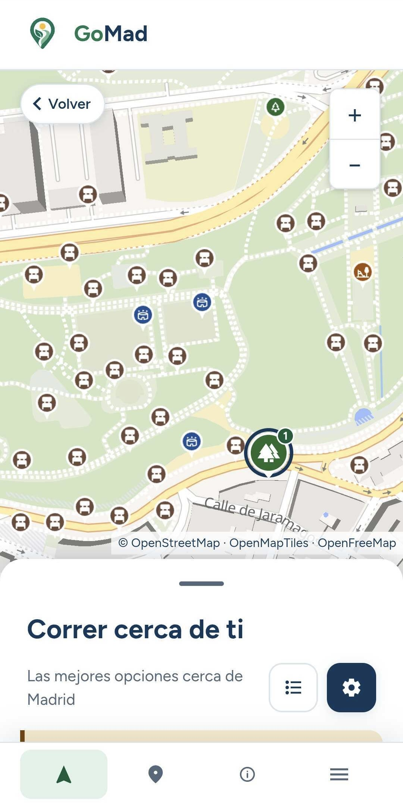
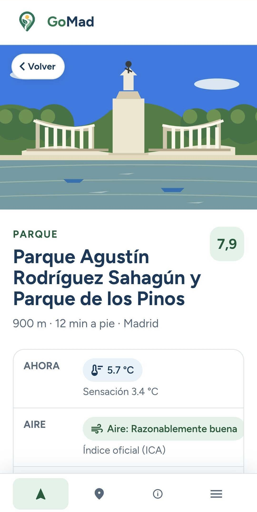
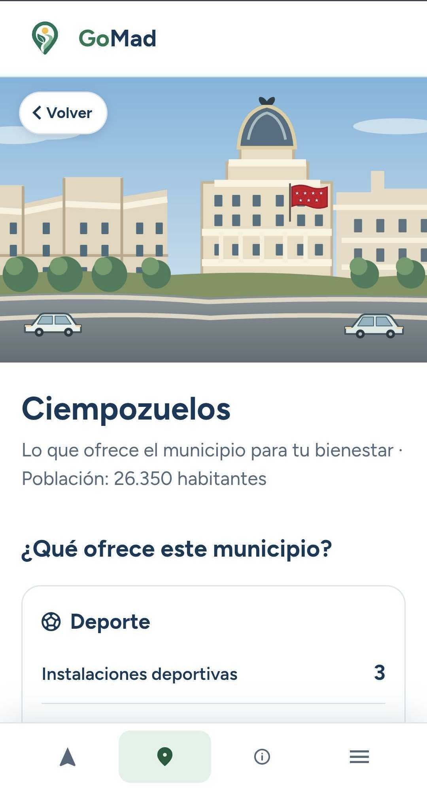

# GoMad · Guía de Ocio: Madrid Activo y Deportivo

## :ok_man: Autores

- Javier Rosales Lozano
- Manuel Roldán Matea
- Nahuel Sebastian Vargas
- Jaime del Campo Montana

GoMad recomienda destinos y rutas para moverse por la Comunidad de Madrid a partir de datos abiertos, preferencias personales y condiciones del entorno.

<p align="center">
  <a href="https://gomaduc3m.duckdns.org/">
    
  </a>
  <a href="https://datathon-mad.sel.inf.uc3m.es/">
    
  </a>
</p>

## :globe_with_meridians: Contexto de la competición


GoMad se desarrolló para el **MAD Open Data Challenge 2026**, un concurso dirigido a estudiantes de universidades de la Comunidad de Madrid. El reto pedía soluciones tecnológicas útiles para la ciudadanía en ámbitos como transporte, servicios sociales, bienestar y salud, con un uso central de los datos abiertos de la Comunidad de Madrid y la posibilidad de enriquecerlos con otras fuentes públicas. La fase inicial consistió en presentar la idea y la fase final, celebrada el **20 de octubre de 2026**, en presentar un prototipo.

La propuesta de GoMad aborda el bienestar y la movilidad cotidiana: ayuda a descubrir dónde caminar, correr o practicar deporte y cómo llegar considerando cercanía, zonas verdes, calidad del aire y meteorología. El ámbito es **toda la Comunidad de Madrid (179 municipios)**; Getafe se utilizó como municipio piloto durante el desarrollo.

## :book: Resumen

El usuario indica una ubicación por GPS, dirección o municipio, elige una actividad y puede ajustar su perfil y preferencias. GoMad reúne destinos de distintas fuentes, explica las recomendaciones y permite comparar una ruta directa con otra que favorece condiciones más saludables. También ofrece información de los municipios y un asistente para expresar rutas en lenguaje natural.

La aplicación se divide en tres piezas: una interfaz web en React, una API en FastAPI y un proceso de ingesta que descarga, normaliza y cruza fuentes públicas para construir bases DuckDB y un grafo peatonal. Los datos generados no se incluyen en Git: cada instalación debe generarlos.

## :round_pushpin: Funcionalidades

- **Descubrimiento de destinos:** React y MapLibre GL muestran la lista y el mapa. FastAPI consulta en DuckDB un catálogo unificado de destinos creado con datos de la Comunidad, el Ayuntamiento y OpenStreetMap; el buscador de direcciones utiliza Nomecalles.
- **Recomendaciones adaptadas:** el motor de reglas en Python calcula una puntuación ponderada por cercanía, actividad, verde, aire y tiempo. Combina mediciones de calidad del aire con previsiones de Open-Meteo para sugerir franjas horarias y alternativas cubiertas.
- **Rutas peatonales:** la ingesta construye un grafo a partir de la red de OpenStreetMap con pyosmium. La API lo carga con igraph y calcula rutas mediante A* o Dijkstra, con costes por tramo que permiten comparar el recorrido directo y el saludable; MapLibre GL dibuja ambos en el mapa.
- **Preferencias y perfiles:** la interfaz React permite ajustar distancia, duración y pesos; la API aplica reglas para perfiles como persona mayor, carrito o sensibilidad a la contaminación.
- **Vista municipal:** la ingesta agrega indicadores de deporte, naturaleza, movilidad, salud, educación, conectividad y servicios en DuckDB; FastAPI los entrega a la interfaz con sus fuentes y cobertura.
- **Asistente de rutas:** un diccionario y reglas en Python interpretan el texto dentro de un catálogo de condiciones. OCI Language puede complementar el análisis; los parámetros se pueden editar y las explicaciones se generan con plantillas a partir del resultado del motor.
- **Transparencia de datos:** el catálogo YAML de fuentes alimenta la página de procedencia y fechas; la interfaz diferencia mediciones, previsiones y datos sin cobertura.

## :camera: Capturas de pantalla

<table border="0" width="100%">
  <tr>
    <th align="center" width="25%">Inicio</th>
    <th align="center" width="25%">Resultados</th>
    <th align="center" width="25%">Recomendación</th>
    <th align="center" width="25%">Municipio</th>
  </tr>
  <tr>
    <td align="center"></td>
    <td align="center"></td>
    <td align="center"></td>
    <td align="center"></td>
  </tr>
</table>

## :link: Tecnologías y dependencias

<table border="0" width="100%">
  <tr>
    <th align="center" width="50%">Lenguajes de programación</th>
    <th align="center" width="50%">Backend y API</th>
  </tr>
  <tr>
    <td align="center"></td>
    <td align="center"></td>
  </tr>
  <tr>
    <th align="center">Desarrollo web y mapas</th>
    <th align="center">Bases de datos e ingesta</th>
  </tr>
  <tr>
    <td align="center"></td>
    <td align="center"></td>
  </tr>
  <tr>
    <th align="center">Infraestructura y despliegue</th>
    <th align="center">Testing y calidad</th>
  </tr>
  <tr>
    <td align="center"></td>
    <td align="center"></td>
  </tr>
</table>

| Capa | Tecnologías y versiones principales |
|---|---|
| Frontend | React 19, TypeScript 6, Vite 8, React Router 7 y MapLibre GL 6 para la interfaz y el mapa. |
| API y motor | Python 3.12, FastAPI 0.115, Pydantic 2, NumPy 2, SciPy 1.14 e igraph 0.11 para recomendaciones, reglas y rutas. |
| Ingesta y almacenamiento | Python 3.12, GeoPandas 1, Shapely 2, PyArrow 17, GeoParquet, DuckDB 1.1 y pyosmium 3.7 para preparar los datos y el grafo peatonal. |
| Datos públicos | Portal de Datos Abiertos de la Comunidad de Madrid, IDEM/EIEL, Nomecalles, Ayuntamiento de Madrid, OpenStreetMap y Open-Meteo, según la cobertura de cada capa. |
| Asistente y despliegue | Reglas y plantillas con OCI Language opcional; Docker Compose y Caddy para servir la aplicación con HTTPS. |

La ingesta combina datos del Portal de Datos Abiertos de la Comunidad de Madrid, IDEM/EIEL, Nomecalles, el Ayuntamiento de Madrid, OpenStreetMap y Open-Meteo. Normaliza formatos, códigos municipales y coordenadas antes de construir las bases DuckDB y el grafo peatonal. La API consulta las bases en lectura y usa datos actualizados de aire y previsión cuando están disponibles. Las recomendaciones son orientativas: la cobertura y vigencia de los datos varían por municipio y fuente; la interfaz muestra esas limitaciones. No se requiere registro de usuarios y la ubicación no se guarda en los registros de la API.

Las versiones y dependencias completas están fijadas en [`app/frontend/package.json`](app/frontend/package.json), [`app/api/pyproject.toml`](app/api/pyproject.toml) y [`app/ingest/pyproject.toml`](app/ingest/pyproject.toml).

## :card_file_box: Fuentes de datos de la Comunidad de Madrid

GoMad utiliza estos repositorios públicos de la Comunidad de Madrid. El [catálogo de fuentes de la aplicación](app/config/sources.yaml) recoge también las fuentes complementarias y sus licencias.

| Repositorio | Conjuntos utilizados |
|---|---|
| Portal de Datos Abiertos de la Comunidad de Madrid | Calidad del aire, desfibriladores, centros sanitarios, farmacias, centros educativos y de atención social, y padrón. |
| Infraestructura de Datos Espaciales de Madrid (IDEM) | Capas de la EIEL 2023 (instalaciones deportivas, parques y núcleos), zonas verdes del planeamiento, áreas recreativas, vías pecuarias y límites municipales. |
| Nomecalles | Callejero, instalaciones deportivas, parques y paradas o estaciones de transporte público. |

Enlaces a los portales: [Datos Abiertos de la Comunidad de Madrid](https://datos.comunidad.madrid/), [IDEM](https://idem.comunidad.madrid/catalogocartografia) y [Nomecalles](https://gestiona.comunidad.madrid/nomecalles_web/). Los datos del [Ayuntamiento de Madrid](https://datos.madrid.es/), [OpenStreetMap](https://www.openstreetmap.org/) y [Open-Meteo](https://open-meteo.com/) complementan las fuentes regionales.

## :construction: Estructura del proyecto

```text
app/
├── api/        # API, motor de recomendaciones, rutas y asistente
├── frontend/   # Aplicación web React
├── ingest/     # Descarga, normalización y construcción de datos y grafo
├── config/     # Actividades, pesos, umbrales y catálogo de fuentes
├── deploy/     # Docker Compose y configuración de Caddy
└── data/       # Datos generados localmente; fuera de Git
docs/          # Contexto, arquitectura, decisiones y análisis de fuentes
README.md      # Presentación y guía de arranque
```

Para profundizar en las decisiones y las fuentes, consulta [el contexto del proyecto](docs/contexto-muevete-cerca.md), [la arquitectura](docs/arquitectura.md) y [el informe de datos](docs/informe-datos.md).

## Requisitos

- Docker Engine o Docker Desktop con Docker Compose v2, conexión a Internet y espacio para las descargas y las bases. La construcción del grafo requiere aproximadamente 4 GB de RAM.
- Para ejecutar sin Docker: Python 3.12 y Node.js 22. El frontend usa `npm ci` y las dependencias fijadas en `package-lock.json`.
- Puerto 80 libre para el frontend de Docker; 5173 y 8000 para el modo de desarrollo. En sistemas donde el puerto 80 requiere privilegios, cambia el puerto del host en `app/deploy/docker-compose.yml` antes de arrancar.

## Arranque local con Docker

Desde la raíz del clon:

```bash
cp app/.env.example app/.env
cp app/deploy/.env.example app/deploy/.env
cd app
docker compose --env-file deploy/.env -f deploy/docker-compose.init.yml run --rm ingest
docker compose --env-file deploy/.env -f deploy/docker-compose.yml up -d --build
curl -fsS http://localhost/api/health
```

La ingesta descarga datos abiertos de la Comunidad y el Ayuntamiento de Madrid, OpenStreetMap y Open-Meteo; puede tardar y algunas fuentes pueden fallar temporalmente. El comando de ingesta devuelve error si falló algún paso: comprueba su salida y vuelve a ejecutarlo. Los ficheros se escriben en `app/data/`, ignorado por Git. La API necesita `app/data/gomad.duckdb`, `app/data/realtime.duckdb` y el grafo para ofrecer todos los resultados. Para parar: `docker compose --env-file deploy/.env -f deploy/docker-compose.yml down`. El script `app/deploy/deploy.sh` usa el checkout actual y no hace `git pull`.

`app/deploy/.env` contiene `DOMAIN=:80` para HTTP local. Para publicar en un dominio propio, configura `DOMAIN` con ese dominio y su DNS; Caddy obtendrá HTTPS. No pongas claves en ese archivo: las variables de la API van en `app/.env`.

## Desarrollo sin Docker

Primero genera los datos con el comando de ingesta anterior. Después, en dos terminales:

```bash
cd app/api
python3.12 -m venv .venv
. .venv/bin/activate
python -m pip install -e '.[dev]'
set -a; . ../.env; set +a
uvicorn main:app --host localhost --port 8000 --no-access-log
```

```bash
cd app/frontend
npm ci
npm run dev
```

Abre `http://localhost:5173`; Vite reenvía `/api` a `localhost:8000`. Si utilizas una API **tuya** en otro servidor, copia `app/frontend/.env.example` a `app/frontend/.env` y establece `GOMAD_API=https://tu-dominio.example` (el servidor debe servir `/api`). `app/frontend/.env` queda ignorado por Git. También puedes exportar `GOMAD_API` en la terminal.

## Variables y credenciales

| Archivo / variable | Uso | Obligatoria |
|---|---|---|
| `app/.env`: `GOMAD_LIVE` | `off` lee las bases locales sin actualización en vivo; quita `off` para activar la actualización según la configuración. | No |
| `GOMAD_DATA_DIR`, `GOMAD_CONFIG_DIR`, `GOMAD_LIVE_SNAPSHOT` | Rutas alternativas al ejecutar Python directamente. | No |
| `IA_PROVEEDOR`, `OCI_COMPARTMENT_ID`, `OCI_REGION`, `OCI_CONFIG_FILE` | OCI Language para el asistente. Sin credenciales, usa el diccionario local. | No |
| `app/deploy/.env`: `DOMAIN` | Host de Caddy; `:80` en local. | Sí, con Compose |
| `app/frontend/.env`: `GOMAD_API` | URL de una API propia para el servidor de desarrollo. | No |

El funcionamiento básico no necesita API keys: las fuentes activas de datos abiertos y Open-Meteo son públicas. Si quieres OCI Language, crea una cuenta y credenciales en la [consola de Oracle Cloud](https://cloud.oracle.com/), anota el identificador de tu compartimento y la región en `app/.env`, y guarda el fichero de configuración y la clave privada **fuera del repositorio**. En Docker, define `OCI_DIR` con la ruta absoluta de esa carpeta en `app/deploy/.env` y añade `-f deploy/docker-compose.oci.yml` al comando de arranque. El fichero de OCI debe referirse a su clave dentro del contenedor en `/oci/`. OCI Language es opcional y puede tener costes de uso.

No se usan `IA_API_KEY`, `IA_MODELO`, `ORACLE_USER`, `ORACLE_PASSWORD`, `ORACLE_DSN` ni `ORACLE_WALLET_DIR` en el código actual. No hace falta obtener claves de AEMET: la previsión activa se obtiene de Open-Meteo. Mantén `app/.env`, `app/deploy/.env`, `app/frontend/.env`, los wallets, las claves privadas y `app/data/` fuera de Git.

## Pruebas

```bash
cd app/api && python3.12 -m venv .venv && . .venv/bin/activate && python -m pip install -e '.[dev]' && pytest -q
cd ../ingest && python3.12 -m venv .venv && . .venv/bin/activate && python -m pip install -e '.[routing,dev]' && pytest -q
cd ../frontend && npm ci && npm test && npm run lint && npm run build
```

Algunas pruebas de Python marcadas como `slow` requieren los datos generados. Las pruebas de frontend incluyen datos de muestra locales y no llaman a servicios externos.

## Problemas frecuentes

- `502` desde Caddy: comprueba `docker compose --env-file deploy/.env -f deploy/docker-compose.yml ps` y los logs del servicio `api`.
- Resultados vacíos o error de datos: comprueba la salida de la ingesta y que `app/data/` contiene las bases y el grafo.
- Fallos al escribir `app/data/` en Linux: ejecuta la ingesta con `GOMAD_UID=$(id -u) GOMAD_GID=$(id -g)` exportadas en la terminal.
- Puerto 80 ocupado: cambia el primer valor de `ports` del servicio `frontend` y accede al nuevo puerto.
- OCI no disponible: la aplicación sigue usando el diccionario local. Revisa `OCI_DIR`, `OCI_CONFIG_FILE` y los permisos de tus archivos privados si deseas activarlo.

Los documentos históricos en `docs/` describen decisiones y despliegues anteriores; los comandos anteriores son la referencia para una instalación nueva.
